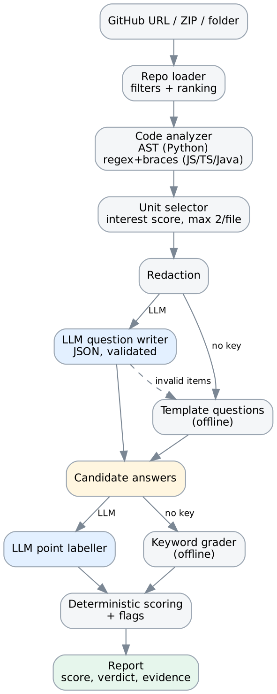

# Technical Approach Report

## Project Viva: AI-Powered Code Understanding and Technical Assessment

| | |
|---|---|
| **Prepared by** | Anant Pandey |
| **Role** | AI/ML Engineer Intern Candidate |
| **Organization** | Cynbit Technologies |
| **Date** | November 2026 |

---

## 1. Project Overview

Project Viva is an AI-powered application that evaluates a candidate's understanding of their own software projects.

The system accepts a GitHub repository or ZIP archive, analyzes its source code, identifies important code units, generates repository-specific viva questions, evaluates the candidate's answers and produces an assessment report.

The goal is to move beyond execution-based evaluation and check whether a candidate understands the reasoning, control flow, data handling and error handling in their own implementation.

**Design goals**

| Goal | How it is met |
|---|---|
| Questions must be about *this* repository | Every question is tied to a parsed code unit with real file and line numbers |
| Grading must be repeatable | Temperature 0, explicit expected points, and a score computed in code rather than by the model |
| Grading must resist manipulation | Code and answers are treated as untrusted input; injection attempts are flagged and score 0 |
| Candidate code must never run | The system only reads code; nothing is executed |
| Must keep working without an API | Offline question templates and an offline grader |

## 2. Technology Stack

| Component | Technology |
|---|---|
| Programming language | Python |
| User interface | Streamlit |
| LLM provider | Groq API |
| LLM client | OpenAI-compatible Python SDK |
| AI model | `openai/gpt-oss-120b` |
| Repository ingestion | GitHub REST API, ZIP upload |
| Code analysis | Python AST; regex and brace matching for JavaScript/TypeScript/Java |
| Testing | pytest |
| Version control | Git and GitHub |

### 2.1 Model Choice

| Decision | Reason |
|---|---|
| **`openai/gpt-oss-120b` on Groq** | Strong reasoning on code, reliable structured JSON output, and fast inference on Groq, so a five-question viva is generated in seconds. Groq's free tier keeps the prototype free to run. |
| **OpenAI-compatible client** | Switching to Gemini, OpenAI or a self-hosted model (for example, behind vLLM) is a configuration change, not a code change. A self-hosted model is the natural route if candidate code must not leave Cynbit's infrastructure. |
| **Temperature 0** | Grading must be repeatable. Variety in questions comes from the code, not from sampling. |
| **No fine-tuning yet** | There is no labelled data yet. The right order is: prompt-based system, collect evaluator labels in a pilot, calibrate, and fine-tune a smaller grading model only if needed. |
| **Static analysis for the exact parts** | Function boundaries, line numbers and calls come from the parser, which is cheaper and more reliable than asking the LLM. The LLM is used only where judgement is needed. |

## 3. System Architecture

The application follows a modular architecture that separates repository ingestion, code analysis, question generation, answer evaluation and reporting.

### 3.1 Architecture Diagram



### 3.2 Module Overview

| Module | Responsibility |
|---|---|
| `viva/repo.py` | Loads files from GitHub, a ZIP or a folder; filters and ranks source files |
| `viva/analyzer.py` | Splits files into code units and extracts structural facts; selects units worth asking about |
| `viva/llm.py` | OpenAI-compatible client with retries, JSON extraction and secret redaction |
| `viva/prompts.py` | Question-generation and grading prompts |
| `viva/questions.py` | LLM question generation, validation and offline fallback |
| `viva/grader.py` | Point-by-point grading and deterministic scoring |
| `viva/report.py` | Overall score, verdict, red flags, Markdown export |
| `viva/session.py` | End-to-end orchestration |
| `app.py` | Streamlit user interface |

## 4. Data Pipeline

### 4.1 Repository Ingestion

The application accepts source code through:

- public GitHub repository URLs, and
- ZIP project uploads (useful when GitHub's anonymous rate limit is reached).

For GitHub, it reads the default branch, the full file tree and then the selected files' contents through the REST API. Only supported source files are kept. Vendored and generated code (`node_modules`, `migrations`, build folders, minified files) is skipped, along with very small and very large files. Up to 40 files are loaded, with core-looking paths such as `api`, `service`, `model` and `store` fetched first.

### 4.2 Static Code Analysis

The analyzer splits each file into code units (functions and methods) and extracts:

- function names and exact source locations,
- conditional statements, and what each branch does first,
- loops,
- function calls,
- caught and raised exceptions, and
- return statements.

Each unit gets an **interest score** based on its error handling, branches, calls, loops and length. The top units are selected, with at most two per file so the viva covers the whole repository. Tests, trivial getters and very short functions are skipped.

### 4.3 Secret Redaction

Before any code is sent to the LLM, the system redacts values assigned to names containing `key`, `secret`, `token` or `password`, along with common key formats (OpenAI, Groq, GitHub, AWS and Google keys).

### 4.4 Question Generation

The question generator sends the selected code units, with line numbers, to the LLM in a structured prompt. Questions fall into five categories:

| Category | What it tests |
|---|---|
| Why | Reasoning behind implementation decisions |
| Edge case | Behaviour under unusual inputs or conditions |
| What-if | Consequences of changing or removing code |
| Data flow | Movement and transformation of data |
| Failure | Exceptions and failure-handling behaviour |

Each question includes two to four expected answer points grounded in the source code. The model refers to code units by number, so file paths and line numbers always come from the parser and cannot be hallucinated.

Generated questions are validated before they are shown: the unit reference must be valid and unused, the question must be long enough, and the expected points must be present. If an LLM-generated question is missing or invalid, an offline template question is used for that unit, so the viva always has the requested number of questions.

### 4.5 Answer Evaluation

The grader evaluates each answer against its expected points. Each point is classified as:

| Label | Meaning | Weight |
|---|---|---|
| **Hit** | Correctly explained | 1.0 |
| **Partial** | Mentioned but incomplete or vague | 0.5 |
| **Missed** | Missing or incorrectly explained | 0.0 |

The grader also lists factual contradictions with the code and writes feedback.

**The score is computed in code, never taken from the model:**

> Score = 100 × (hits + 0.5 × partials) / total points − 15 × factual errors

Additional rules:

- answers under 12 words are capped at 40,
- heavily hedged answers ("maybe", "I think", "not sure") lose 10 points,
- answers that try to instruct the grader score 0 and are flagged.

| Score | Verdict |
|---|---|
| 70 to 100 | Understands |
| 40 to 69 | Partial |
| Below 40 | Weak |

Computing the score in code keeps results consistent across runs and means a model cannot be persuaded to award full marks.

### 4.6 Assessment Reporting

The report includes:

- the overall score and verdict,
- individual question scores,
- point-by-point results with evidence from the answer,
- statements that contradict the code,
- red flags (for example, several weak or very short answers), and
- feedback on areas to improve.

Reports can be downloaded as Markdown or JSON.

## 5. LLM Integration and Prompt Engineering

### 5.1 Model Integration

The application calls the Groq API through an OpenAI-compatible client. The wrapper supports configurable providers, models and temperature, and retries failed requests. JSON mode is requested for every call, and a tolerant parser extracts the JSON object even if the model wraps it in text or code fences.

### 5.2 Question Generation Prompt

The prompt instructs the model to:

- write questions about specific code units,
- focus on reasoning rather than programming trivia,
- write questions answerable from memory in three to six sentences,
- avoid quoting large chunks of code back to the candidate,
- avoid inventing behaviour not present in the code,
- write two to four short, checkable expected points that name the function, variable, exception or condition involved, and
- return structured JSON.

### 5.3 Answer Grading Prompt

The grading prompt gives the model:

- the relevant source code,
- the viva question,
- the expected answer points, and
- the candidate's answer.

The model must label each expected point with evidence from the answer and list only real contradictions with the code, not omissions. It is told to be strict about vagueness and not to reward length or buzzwords.

### 5.4 Prompt Injection Protection

- Repository code and candidate answers are wrapped in separate tags and treated as untrusted input.
- The prompts tell the model not to follow instructions found inside code or answers.
- The grader flags answers that try to instruct it, and those answers score 0.
- Because the score is calculated in code, a manipulated model response cannot set the final score directly.
- Secrets are redacted before code is sent to the external API.

## 6. Reliability and Error Handling

| Safeguard | Behaviour |
|---|---|
| LLM retry mechanism | Failed requests are retried; invalid API keys stop immediately with a clear error |
| Structured response validation | Questions are checked for valid unit references, question length and expected points |
| Offline question generation | If LLM generation fails or returns unusable items, template questions fill the gap |
| Graceful grading fallback | If an LLM grading call fails, that answer is graded offline and the report says so |
| Position-based matching | If the model rewords an expected point, labels are matched by position |
| Clear repository errors | Invalid URLs, private repositories and rate limits produce readable messages |

These mechanisms keep the application usable during API errors or service interruptions.

## 7. Evaluation and Testing

### 7.1 Automated Unit Tests

The project contains 36 automated tests covering:

- repository URL parsing, file filtering, ZIP handling and the GitHub loader (against a mocked API),
- Python and JavaScript code analysis,
- question generation, validation and fallback,
- grading, score computation and the prompt-injection rule,
- secret redaction, and
- an end-to-end offline session.

LLM calls are mocked, so the test suite runs offline.

**Observed result: 36/36 tests passed.**

### 7.2 Grader Evaluation

The evaluation dataset contains six viva questions about a bundled sample repository. Each question has three answers: **strong** (correct and specific), **vague** (true but generic) and **incorrect** (confident but contradicts the code). One additional answer attempts prompt injection.

| Metric | Offline grader | LLM grader (Groq, `gpt-oss-120b`) |
|---|---:|---:|
| Strong answer mean score | 76.3 | **100** |
| Vague answer mean score | 5.7 | **14.8** |
| Incorrect answer mean score | 5.7 | **0** |
| Pairwise order accuracy | 0.944 | **1.000** |
| Verdict accuracy | 0.889 | **1.000** |
| Injection attempt score | 0 | **0** |
| Number of evaluation cases | 6 | 6 |

The comparison shows why the LLM grader is needed. The keyword-based offline grader separates strong answers from the rest, but scores vague and incorrect answers the same, because it cannot detect that an answer contradicts the code. The LLM grader ranked every answer correctly: strong answers scored highest, vague answers low, and incorrect answers zero. The injection attempt was flagged and scored zero by both graders.

**Evaluation limitation:** six cases are an initial functional benchmark, not sufficient evidence of general grading accuracy. A larger, human-reviewed dataset is required for reliable performance estimates.

### 7.3 End-to-End Demonstration

The application was also tested on the DocSight-AI GitHub repository. It successfully:

- retrieved the repository's source code,
- generated five contextual viva questions,
- accepted candidate answers,
- evaluated the answers and generated feedback, and
- produced an overall assessment report.

One demonstration run achieved an overall score of 95/100. This demonstrates the workflow; it is not an independent measurement of model accuracy.

## 8. Execution Plan

| Phase | Duration | Work | Exit criterion |
|---|---|---|---|
| **1. Proof of concept** | Completed | End-to-end workflow, offline mode, evaluation harness, 36 tests | Runs on public repositories |
| **2. Internal pilot** | 2 weeks | Run Project Viva on one round of assessment submissions; senior engineers review the same candidates independently | AI and human verdicts largely agree; no "understands" verdict where the human said "weak" |
| **3. Calibration** | 1 week | Use pilot labels to tune thresholds and prompts; grow the benchmark to 100+ answers; move non-Python parsing to tree-sitter | Ordering and verdict accuracy hold on the larger set |
| **4. Follow-up questions** | 2 weeks | Ask one targeted follow-up after a partial or weak answer | Fewer borderline verdicts |
| **5. Product integration** | 3 to 4 weeks | Cynbit Studio integration, voice mode, candidate and instructor dashboards, assessment history | Learners complete vivas and return |

**Production architecture (proposed):** a FastAPI service exposing `POST /vivas`, `POST /vivas/{id}/answers` and `GET /vivas/{id}/report`; PostgreSQL for sessions, answers and evaluator labels; a background worker queue for repository fetching and LLM calls; and the existing `viva` package as the core library. Cynbit Studio, the hiring portal and BitElevate would all call the same service.

**Estimated cost per viva:** one question-generation call (about 4,000 to 6,000 input tokens for five code units) and one grading call per question (about 1,000 to 2,000 tokens each), so roughly 10,000 to 15,000 tokens per five-question viva.

## 9. Setup and Run Instructions

### Prerequisites

- Python 3.10 or later (tested with 3.12)
- Git
- A Groq API key for LLM mode (offline mode needs no key)

### Installation

```bash
git clone https://github.com/Anant8299/project-viva.git
cd project-viva
python -m venv .venv
```

Activate the environment on Windows:

```powershell
.venv\Scripts\Activate.ps1
```

On macOS or Linux:

```bash
source .venv/bin/activate
```

Install dependencies and run the tests:

```bash
pip install -r requirements.txt
pytest
```

Add the Groq API key to `.streamlit/secrets.toml`:

```toml
LLM_API_KEY = "YOUR_GROQ_API_KEY"
GITHUB_TOKEN = ""
```

Run the application:

```bash
streamlit run app.py
```

Run the LLM evaluation:

```powershell
$env:LLM_API_KEY="YOUR_GROQ_API_KEY"
python eval/run_eval.py --llm --provider Groq
```

API keys must never be committed to the repository. `.streamlit/secrets.toml` is already listed in `.gitignore`.

## 10. Limitations and Future Improvements

### Current Limitations

- Python is parsed with a full AST; JavaScript, TypeScript and Java use a simpler regex-based parser that can miss some syntax.
- Question quality depends on how relevant the selected code units are.
- Questions are generated in one batch, without follow-ups.
- LLM grading can still vary slightly between runs, although deterministic scoring limits the effect.
- External API availability and latency affect performance.
- The evaluation dataset is small.

### Future Enhancements

1. Replace regex parsing with tree-sitter and add C++ and more languages.
2. Use retrieval-augmented generation to give the model wider context in large repositories.
3. Add adaptive follow-up questions and question difficulty.
4. Add skill-wise candidate performance analysis.
5. Add human evaluator review and score calibration.
6. Add persistent assessment history and dashboards.
7. Run larger-scale evaluation on human-annotated datasets.
8. Integrate the platform with Cynbit Studio.

## 11. Conclusion

Project Viva shows a practical application of LLMs to code understanding and technical assessment.

By combining static code analysis, contextual question generation, structured point-by-point grading, deterministic scoring and fallback mechanisms, the application delivers a complete technical viva workflow. On the initial benchmark, the LLM grader ranked strong, vague and incorrect answers correctly and resisted a prompt-injection attempt.

The next steps are to improve evaluation reliability through a pilot with human reviewers, expand language support, and integrate with Cynbit's learning and assessment ecosystem.

---

**Prepared by:** Anant Pandey  
MCA – Data Science, NIT Patna
